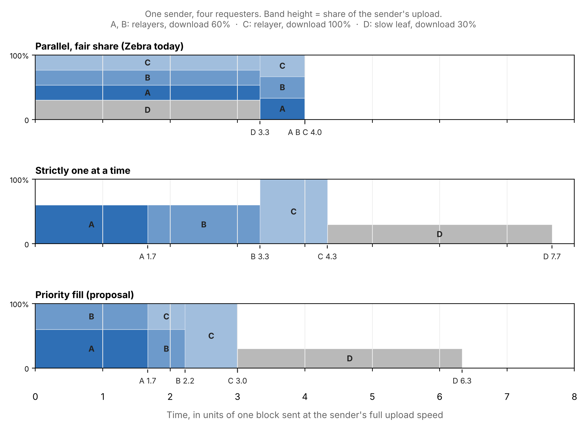
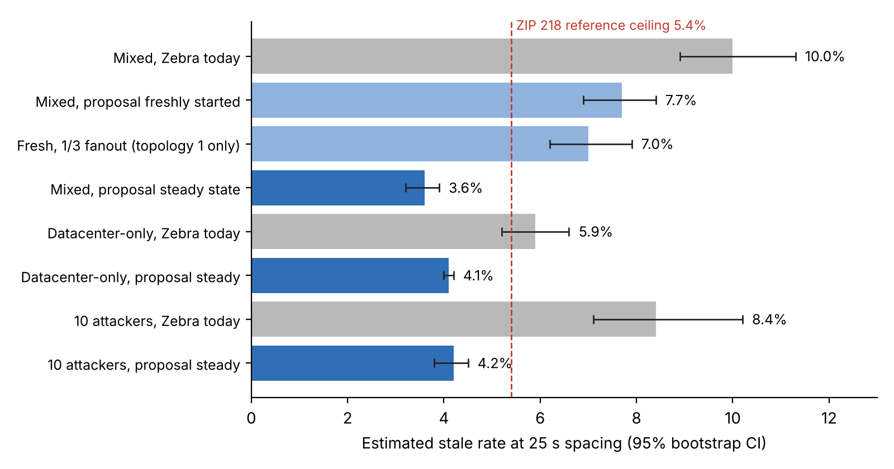

## Abstract

**Status: discussion draft.** This paper proposes an idea and reports early experimental evidence. It is not a specification, the code is not ready for implementation, and nothing here should be deployed. Its purpose is to start a discussion about whether and how Zcash nodes should schedule block uploads.

When a Zebra node relays a new block, it answers every peer's request at the same time, so its upload is split evenly and every peer finishes at about the same moment. We propose **priority fill**: serve the peers most likely to relay the block onward first, at their full download speed, and give any spare upload to the next peer in line. Peers are ranked by the throughput a node has measured from them in the past.

In a 100-node testbed built on Zebra's own networking code, with 2 MB blocks every 25 seconds, the spacing Zcash adopts under ZIP 218 with the NU7 upgrade on 5 November 2026, priority fill delivered blocks to other miners in a median of 0.82 s instead of 2.67 s. The estimated stale rate fell from 10.0% to 3.6%, below the 5.4% ceiling ZIP 218 uses as a reference. If this held on mainnet, it would raise the hashrate an attacker needs to out-mine the network, reduce the confirmations needed against double-spends, and cut the revenue advantage that the move to 25-second blocks gives large mining pools by about two thirds. With block arrivals following a Poisson process, as in real mining, a 1,000-node model of the same relay counted 16.2% of blocks orphaned under today's relay and 6.0% with priority fill; most orphans come from blocks found within seconds of each other, which is exactly where priority fill helps most.

The gain depends on assumptions not yet verified on a real network. It needs nodes that have learned their peers' throughput; freshly started nodes recovered only about a quarter of it. It does not help the slowest 10% of nodes. It also introduces a ranking that attackers can try to game: ten slow-reading attackers delayed the slowest nodes by 0.8 s, and by 0.4 s once a demotion rule was added to the experimental code. We describe these risks, the mitigations we tested, and the open questions that would need answers before any implementation.

## 1. Introduction

Zcash is about to move to 25-second blocks. [ZIP 218](https://zips.z.cash/zip-0218), activating with the NU7 network upgrade on 5 November 2026, cuts the target block spacing from 75 s to 25 s and keeps the 2 MB block limit. With a third of the time between blocks, the same propagation delay will take up three times as large a share of each interval, so more blocks will go stale and more proof of work will secure nothing. Relay speed is about to become a direct lever on how much of Zcash's hashrate actually counts. ZIP 218's own figures frame the cost: the mainnet stale rate is about 0.4% at today's 75 s spacing, its theoretical estimate at 25 s is about 3.26%, and a 99-node Zebra devnet with 2 MB blocks measured 4.86%, against a 5.4% reference ceiling.

A stale block is honest work thrown away. A higher stale rate lowers the hashrate an attacker needs, weakens each confirmation, and, because a pool never orphans its own blocks, pays large pools more than small ones. ZIP 218 itself links the stale rate to mining centralization.

Most relay work shrinks what is sent: compact blocks, set reconciliation, error-correcting UDP. This paper looks at a different lever, the **order** in which a node uploads a block to the peers that ask for it. It costs no extra bandwidth, needs no protocol or consensus change, and is local to each node. It complements compact block relay rather than replacing it: compact blocks shrink most transfers, and upload order matters most for the full-block transfers that remain, such as when mempools diverge during spam.

The contributions are a description of the idea and its theory (sections 3–4), simulations and a 100-node testbed on Zebra's networking code (sections 5–6), an analysis of the security effect (section 7), and an honest account of the risks, trade-offs and open questions (sections 8–11).

## 2. Background: how Zebra relays blocks today

Zebra is now the only full-node implementation on the network; zcashd reached end of support in July 2026. In current Zebra `main`, block relay works as follows:

1. A node that has validated a new block sends an `inv` with its hash to a random third of its connected peers, or to all of them if it mined the block. Gossip of new tips is spaced at least 7 s apart.
2. A peer that lacks the block requests it from the first peer whose `inv` reached it, routed through Zebra's inventory registry. One download per block is in flight at a time.
3. The sender answers each request as it arrives. Concurrent uploads share the link through TCP, so each gets roughly an equal share of the sender's upload.

Zebra has no compact block relay in production. An opt-in implementation modelled on Bitcoin's BIP 152 is [under review](https://github.com/ZcashFoundation/zebra/pull/11938) as of October 2026.

Step 3 is the subject of this paper. With *k* requesters and a block that takes time *t* to send at full upload, fair sharing delivers every copy at about *k·t*, and no receiver can start relaying before then.

## 3. The idea: priority fill

Priority fill changes only the order and overlap of a node's block uploads. Every requester still receives the block, and no extra bytes are sent.

1. **Rank requesters.** Each node keeps a moving average of the throughput it has measured from each peer when that peer answered its own block requests. Unknown peers get the median.
2. **Serve the best first.** When block requests are waiting, the highest-ranked one is served first at the receiver's full speed.
3. **Fill spare upload.** Another transfer is admitted only when the node's measured upload sits below 85% for 100 ms and at least 50 ms have passed since the last admission. No running transfer is slowed down to make room for a lower-ranked one.
4. **Bound the wait.** Any request waiting longer than 5 s is served next regardless of rank, and none waits more than 10 s for a slot.

A fifth rule protects the ranking. **Demote stalled readers:** each upload has a deadline, the time a reader at a quarter of the expected speed would take, where the expected speed is the lower of the peer's estimate and this node's own upload. An upload still running at its deadline gives up its slot, so the next transfer starts at once, and the peer's rank is capped at the rate it actually read at. A later normal upload to that peer lifts the cap.

The rule adapts to whichever side is the bottleneck. A home node whose upload is slower than any peer's download ends up sending to one peer at a time; a datacenter node sending to home peers runs several transfers at once without slowing any of them.

In Figure 1, fair sharing gets no relayer the block until time 4.0. Strict one-at-a-time gets relayer A going at 1.7 but wastes upload on slower receivers. Priority fill gets A, B and C going at 1.7, 2.2 and 3.0 with no upload wasted while relayers wait. The slow leaf D, which relays to no one, is served last in exchange.

A second, optional change was also tested: announcing relayed blocks to every peer instead of a random third. It made no measurable difference (section 6), so the proposal is the scheduler alone.

## 4. Why it should work

Scheduling theory says sharing an uplink evenly is the wrong goal when some receivers matter more than others. Treat a node's upload as a single machine and each requesting peer *j* as a job. Its processing time is the block size divided by the lesser of the sender's upload *U* and the receiver's download *D_j*. Its weight *w_j* is roughly how many nodes are waiting on it: every second *j* waits, its own relay subtree waits too.

To first order, the total delay a node imposes on the network is the weighted sum of completion times, Σ *w_j·C_j*. Smith's rule minimizes it by serving jobs in descending order of:

$$\pi_j = \frac{w_j}{p_j} \propto w_j \cdot \min(U, D_j)$$

Any division of the uplink is beaten by finishing the highest-priority job first: sharing delays the important peer without delivering anyone earlier. With two equal-size transfers to a peer with 20 neighbours and one with 2, fair sharing gives a weighted delay of 44 units, serving the well-connected peer first gives 24, and the reverse gives 42.

The same idea appears in the broadcast literature as **Fastest Node First**: [Khuller and Kim (2007)](https://unpaywall.org/10.1007%2FS00453-006-1227-9) proved it optimal for the sum of completion times and within 1.5 times the optimum for the last completion. Optimal broadcast scheduling over unequal links is hard in general, so this is a strong greedy rule, not a proven optimum for propagation.

In practice a node knows neither its peers' peer counts nor their upload. In simulation, ranking by measured throughput recovered about 97% of the benefit of knowing true upload speeds, and adding peer counts gained little, because well-connected nodes tend to be the fast ones.

## 5. Method

The idea was tested in two stages: discrete-event simulations to explore it, then a testbed running Zebra's real networking code to check it.

**Simulations.** Python models of 1,000 nodes with uneven bandwidth compared fair sharing, strict sequential sending, fixed concurrency limits and priority fill, with rankings from true speeds, noisy measurements, past announcement order and peer counts.

**1,000-node model.** A second model in JavaScript reproduces the testbed's mechanics at ten times the scale: the same node classes and Zebra's 25 outbound connections, nodes in five regions with one-way latency growing with distance (8–160 ms), Zebra's pull relay (announce a validated block to a random third of peers, fetch from the first announcer, retry elsewhere after 20 s), zebrad's 7 s spacing between tip announcements, a 50 ms validation delay, and bandwidth shared in 2 ms steps. Several blocks can be in flight at once and compete for bandwidth; a node validates a block only after its parent, and miners build on the first-seen longest chain, so orphaned blocks are counted directly. Run at 100 nodes it gives estimated stale rates of 9.1% and 2.7%, close to the testbed's 10.0% and 3.6%.

**Testbed node.** A stateless relay binary links Zebra's `zebra-network` and `zebra-chain` crates from `main` (commit 1e03ee75, October 23, 2026). It uses Zebra's real handshake, wire codec, peer set, inventory routing, block download requests and block advertiser, and mirrors zebrad's gossip loop including the 7 s gossip interval. It keeps no chain state, so block validation is replaced by a fixed 50 ms delay. Blocks are 1.95 MB of transparent transactions.

**Emulated network.** Every peer connection is wrapped so each node's total upload and download are capped and each link has a fixed one-way latency of 20–150 ms. Small socket buffers make slow receivers push back on senders as TCP does. Transfer times were checked against configured rates.

| Node type | Share of nodes | Upload / download | Accepts inbound connections |
| --- | --- | --- | --- |
| Datacenter | 30% | 500 / 500 Mb/s | always |
| Home fiber | 25% | 100 / 500 Mb/s | half |
| Home cable | 35% | 15 / 150 Mb/s | one in five |
| Rural / poor | 10% | 3 / 25 Mb/s | one in twenty |

Each node's rates vary about ±35% around its type. Each node opens Zebra's default 25 outbound connections, so hosted nodes have about 65 peers and home nodes about 25. A second network makes every node a datacenter node, closer to ZIP 218's devnet. A third adds ten slow-reading attackers, described in section 8.

**Runs.** 100 nodes per run; a random datacenter node mines a block every 25 s, all miners with equal hashrate. Each run mines 8 blocks and discards the first 2. Three mixed topologies were each run with current Zebra behaviour and with the proposal. All runs used 4× time dilation (bandwidths divided by 4, every delay multiplied by 4) so that 100 nodes fit on one 2-core machine; event-loop lag stayed under 26 ms of real time at the 99th percentile.

**Poisson block arrivals.** Real blocks arrive as a Poisson process: intervals are exponential with a 25 s mean, so about 11% of blocks come within 3 s of the previous one and about 24% within 7 s. The testbed runs mined on a fixed 25 s schedule. Every model run in section 6.1 mines on a Poisson schedule with the same mean, the same schedule for both modes. Testbed runs with Poisson block arrivals were attempted but could not be used: when blocks arrived seconds apart, 100 nodes on one 8 GB machine ran out of memory and stalled for tens of seconds.

**Learned vs fresh rankings.** A node learns throughput only from blocks it receives, so after 8 blocks it had estimates for about 8% of its peers. To represent a node that has run for hours, "steady state" runs seed each node with its own measured view of every peer, with ±50% error. "Freshly started" runs begin with no estimates.

**Stale-rate estimate.** For each block and each other miner, the chance that miner finds a competing block before it has received and validated this one is 1 − e^(−delay / 25 s), averaged over miners. This is an estimate under equal hashrate, not a count of observed forks.

## 6. Results

Once nodes had learned their peers' throughput, priority fill delivered blocks to other miners 3.3 times faster than current Zebra behaviour and cut the estimated stale rate at 25 s from 10.0% to 3.6%.

| Scenario | Median node receives block | Slowest 10% of nodes | Other miners (median) |
| --- | --- | --- | --- |
| Mixed network, Zebra today | 2.66 s | 3.35 s | 2.67 s |
| Mixed network, proposal freshly started | 1.58 s | 3.53 s | 1.97 s |
| Mixed network, proposal steady state | 1.30 s | 3.38 s | 0.82 s |
| Datacenter-only, Zebra today | 1.57 s | 1.70 s | 1.63 s |
| Datacenter-only, proposal steady state | 0.91 s | 1.78 s | 0.96 s |

Times run from the moment a block is mined until a node has received it, in real seconds.

- **The testbed is in line with ZIP 218.** With every node in a datacenter, current Zebra behaviour gave an estimated 5.9% stale rate, close to the 4.86% ZIP 218 observed on its 99-node devnet. The mixed network, where home connections relay too, was worse at 10.0%.
- **The gain depends on learning.** Freshly started nodes reached 7.7%, recovering only about a quarter of the steady-state gain.
- **The scheduler does the work, not wider announcements.** On one topology, freshly started nodes reached 7.0% with Zebra's one-third announcement fanout and 7.2% when announcing to every peer. Steady state was not tested with one-third fanout.
- **The slowest nodes do not gain.** The slowest 10% received blocks no sooner (3.38 s vs 3.35 s), and on one topology later (3.99 s vs 3.09 s): home nodes rank low and wait in upload queues.
- **Results are consistent across topologies.** Estimated stale rates for current behaviour were 10.1%, 10.0% and 9.8%; for the steady-state proposal 3.1%, 3.4% and 4.1%.
- **Simulations agreed in direction.** With uneven bandwidth, priority fill was 28% faster than fair sharing for 2 MB blocks, while naive one-at-a-time sending was sometimes slower than fair sharing, because a slow receiver leaves the sender's upload idle.

### 6.1 Poisson block arrivals

Mining on a fixed schedule hides forks: when every block comes exactly 25 s after the last, almost every miner has the previous block by then. Real mining is a Poisson process, and blocks that follow each other closely carry most of the risk. The 1,000-node model was run for 900 blocks per row (three networks, 300 blocks each) with Poisson block arrivals, counting orphaned blocks directly.

| 1,000-node model | Zebra today | Priority fill |
| --- | --- | --- |
| Orphaned blocks, fixed 25 s spacing | 0.2% | 0.0% |
| Orphaned blocks, Poisson arrivals, 25 s mean | 16.2% | 6.0% |
| Orphaned, of blocks mined within 7 s of the previous | 64% | 26% |
| Estimated stale rate, Poisson arrivals | 18.3% | 6.7% |
| Median time for a block to reach other miners | 3.44 s | 0.96 s |
| Orphaned blocks, Poisson arrivals, without the 7 s announcement spacing | 13.4% | 3.9% |
| Orphaned blocks, Poisson arrivals, 75 s mean (today, before NU7) | 5.2% | 1.6% |

- **Poisson arrivals turn delay into real forks.** With a fixed schedule the model counts almost no orphans, even though blocks take seconds to arrive. With Poisson arrivals the counted orphan rate (16.2%) is close to the estimate (18.3%), so the estimates used in sections 6 and 7 are a fair guide to what Poisson block arrivals produce.
- **Close blocks are where priority fill matters most.** Under today's relay, nearly two thirds of blocks mined within 7 s of the previous one were orphaned. Priority fill cut that to about a quarter, because the first block reaches other miners before the second is found.
- **The 1,000-node network is harder on today's relay than the 100-node testbed.** More hops mean more chances to wait behind a slow uploader, so today's relay degrades from about 10% at 100 nodes to about 16% at 1,000, while priority fill rises only from about 3% to about 6%.

In this model, priority fill at 25 s orphans about as many blocks (6.0%) as today's relay does at today's 75 s spacing (5.2%). The model's absolute rates run high (mainnet measured 0.4% at 75 s) because every block here is a full 2 MB, hashrate is spread evenly over 40 pools, there are no compact blocks and home connections relay too; the comparison between rows is what it is for.

**An incidental finding: announcement spacing.** zebrad's gossip loop sleeps for PEER_GOSSIP_DELAY (7 s) before each new tip announcement; mined blocks skip the wait, relayed ones do not. The code comment explains that this was sized for blocks every 75 seconds (as of commit 1e03ee75). With Poisson block arrivals at a 25 s mean, about a quarter of blocks arrive at a relay while it is still waiting, and their announcement is held back. Removing the spacing in the model cut orphans from 16.2% to 13.4% under today's relay and from 6.0% to 3.9% with priority fill. This is independent of upload order and a much simpler change, and it may already be addressed in newer Zebra code; it is worth checking either way. Together, the two changes took the model from 16.2% to 3.9%.

## 7. Security implications

If the testbed's stale-rate reduction carried over to mainnet, most of the security cost of 25-second blocks would be recovered. The figures below apply standard models to the estimated stale rates; they assume equal-hashrate miners.

| Stale rate | Hashrate needed to out-mine the network | Confirmations against a 30% attacker (risk below 0.1%) | Revenue edge of a 46% pool over a 1% pool |
| --- | --- | --- | --- |
| 0.4%: mainnet today, 75 s blocks | 49.9% | 24 (30 min) | 0.2% |
| 10.0%: current relay, 25 s blocks, mixed network | 47.4% | 30 (12.5 min) | 4.5% |
| 3.6%: priority fill, 25 s blocks, mixed network | 49.1% | 26 (10.8 min) | 1.6% |
| 5.9%: current relay, datacenter-only network | 48.5% | 27 (11.3 min) | 2.7% |
| 4.1%: priority fill, datacenter-only network | 49.0% | 26 (10.8 min) | 1.8% |
| 16.2%: current relay, Poisson 25 s blocks, 1,000-node model (orphans counted) | 45.6% | 36 (15.0 min) | 7.3% |
| 6.0%: priority fill, Poisson 25 s blocks, 1,000-node model (orphans counted) | 48.5% | 27 (11.3 min) | 2.7% |

**Majority attacks.** Stale blocks are wasted honest work, while an attacker mining privately wastes none. With a stale fraction *s*, an attacker needs (1 − *s*) / (2 − *s*) of total hashrate rather than half.

**Double-spends.** Using Nakamoto's catch-up formula with the attacker's share adjusted for honest stale blocks, a merchant facing a 30% attacker needs 30 confirmations at 10% and 26 at 3.6% for the same 0.1% risk.

**Selfish mining.** [Gervais et al.](https://eprint.iacr.org/2016/555) found that higher stale rates raise a selfish miner's relative revenue. In [Eyal and Sirer's model](https://arxiv.org/abs/1311.0243) profitability depends on how often honest miners build on a withheld block in a race, which is a propagation contest; getting honest blocks to miners faster narrows that window.

**Mining centralization.** A pool never orphans its own blocks, so its stale rate scales with the hashrate outside it; its edge over a small pool is roughly the difference in their shares times the network stale rate. With the largest pool [near 46% of hashrate](https://bedrock-site.pages.dev/blog/announcing-bedrock), the edge would be 4.5% at a 10% stale rate against 0.2% today, and 1.6% with priority fill. In the 1,000-node model with Poisson block arrivals, which counts orphans directly, the edge would be 7.3% under today's relay and 2.7% with priority fill. This is likely the most important long-term effect.

**Caveat.** Real hashrate is concentrated, which lowers measured stale rates (ZIP 218 notes this for the 0.4% measured at 75 s spacing). The direction of every effect above holds, but the absolute numbers should be read as illustrations.

## 8. Risks, trade-offs and mitigations

Priority fill trades fairness for speed and introduces a ranking that attackers can target. Some risks were measured, some were found in a security review of the experimental code, and some remain untested.

### 8.1 A tested attack: slow-reading peers

Ten attackers (10% of nodes) had 500 Mb/s upload, so every honest neighbour ranked them first, and 1 Mb/s download, so they held an upload slot while reading almost nothing. Both modes ran on the same network:

| With 10 attackers | Current relay | Priority fill |
| --- | --- | --- |
| Median node receives block | 2.21 s | 1.41 s |
| Slowest 10% of nodes | 2.62 s | 3.44 s |
| Other miners receive block (median) | 2.22 s | 1.00 s |
| Estimated stale rate | 8.4% | 4.2% |

The attack works only partly, because the scheduler admits the next transfer once upload sits idle for 50 ms. Miners still receive blocks twice as fast, but the network's tail is 0.8 s slower than under current behaviour. This is the clearest cost found.

**With demotion.** The experimental code now demotes stalled readers (section 3). Rerunning the same attack on the same network:

| With 10 attackers | Current relay | Priority fill | Priority fill with demotion |
| --- | --- | --- | --- |
| Median node receives block | 2.21 s | 1.41 s | 1.28 s |
| Slowest 10% of nodes | 2.62 s | 3.44 s | 2.99 s |
| Other miners receive block (median) | 2.22 s | 1.00 s | 0.94 s |
| Estimated stale rate | 8.4% | 4.2% | 3.8% |

Demotion halved the tail cost, from 0.8 s to 0.4 s; nodes released about 55 stalled uploads during the run. The slowest nodes are still slower than under today's relay, so the attack is blunted, not removed. This run shared the machine with other work, so event-loop lag was higher than in earlier runs (96 ms at the 99th percentile). Without attackers, demotion fired only three times in a run and the estimated stale rate was 3.6%, against 3.1% in two runs without it; with six measured blocks per run that gap is within run-to-run variation, but a small cost cannot be ruled out.

### 8.2 Trade-offs

- **Fairness.** Low-ranked peers, mostly home nodes, wait in upload queues (median 0.6 s, longest about 4 s per block). The slowest 10% gain nothing and can lose.
- **Cold start.** The benefit depends on measurements a node accumulates over hours. A fresh node, or one whose peers have churned, behaves closer to today's relay.
- **Complexity.** The scheduler adds state, timers and tuning constants to a security-critical path. The first fairness bounds we tried (0.5 s and 2 s) silently cost two thirds of the gain; they had to be set above normal queue times (5 s and 10 s).
- **Overlap with compact blocks.** Compact blocks would shrink most transfers to a few kilobytes, where order barely matters. Priority fill matters for full blocks, which remain during spam and mempool divergence.

### 8.3 Risks and mitigations

| Risk | What could happen | Mitigation | Status |
| --- | --- | --- | --- |
| Slow-reading peers | A peer earns a high rank, then stalls to delay others | Admit the next transfer when upload goes idle; demote peers whose transfers run far below their estimate | Built and tested: tail cost halved, not removed |
| Starvation | A high-ranked peer that keeps requesting holds the uplink indefinitely | Serve any request waiting over 5 s first; cap waits at 10 s; serve repeat requests for the same block last | Built and tested |
| Rank inflation | A peer sends unsolicited bulk data to look fast | Count only replies to this node's own block requests | Built and tested |
| Ranking capture | Fast attacker nodes rank first everywhere, learn new blocks earliest and become relay chokepoints | Expire estimates; cap top-ranked slots per network prefix; prefer outbound peers; keep a random-choice slot, as BitTorrent's optimistic unchoke does | Expiry built; others proposed |
| Blocked connections | A connection waiting at the scheduler can't answer pings and may be dropped | Bound the wait (10 s, inside Zebra's 20 s request timeout); ideally wait outside the connection's message loop | Bound built; restructuring proposed |
| Resource exhaustion | Estimate tables and served-block records grow without bound | Size caps and expiry | Built and tested |
| Timing exposure | Announcing to all peers gives observers more timing data | Keep one-third fanout, which performed as well for fresh nodes | Recommended |

A security review of the experimental code also found issues unrelated to the idea itself, such as socket leaks and weakened rate limits in the testbed wrapper. These were fixed, and the testbed code is behind an off-by-default feature flag, but they show how easily changes to this layer can harm a node.

## 9. Prior art

The core idea is well established in networking; what appears new is applying upload ordering by measured relay throughput to a cryptocurrency node and measuring its effect on stale rate and attacks.

| Work | What it does | Relation to this proposal |
| --- | --- | --- |
| [Fastest Node First](https://researchr.org/publication/BanikazemiMP98/bibtex) (Banikazemi, Moorthy and Panda, 1998); [Khuller and Kim, 2007](https://unpaywall.org/10.1007%2FS00453-006-1227-9) | Broadcast over unequal links by serving fast nodes first; optimal for the sum of completion times | The theoretical basis of priority fill |
| [BitTorrent choking](https://arxiv.org/pdf/cs/0611105) | Upload to the few peers that send to you fastest, plus one random slot | Ranking by measured throughput, with a random reserve slot as a mitigation |
| [Staggered sending in libp2p gossip](https://arxiv.org/html/2504.10365v1) (Farooq, Cizain and Kaiser) | Send a large message to peers one at a time | Staggering alone increased latency; 3–4 at once beat fully sequential; slow or malicious peers can exploit it without scoring and timeouts. Our results agree |
| [Gossip batch publishing](https://ethresear.ch/t/improving-das-performance-with-gossipsub-batch-publishing/21713) (Codex, 2025) | Send first copies before duplicates when the publisher's uplink is the bottleneck | The same principle applied to data chunks |
| [BIP 152](https://bips.dev/152/) | Push compact blocks to at most 3 peers chosen by past delivery speed | Peer ranking on the receiving side, not upload scheduling |
| [Ethereum devp2p](https://github.com/ethereum/devp2p/blob/master/caps/eth.md) (before the Merge) | Push full blocks to about the square root of peers; announce to the rest | A deliberately narrow fan-out, with random peers |
| [Perigee](https://arxiv.org/pdf/2006.14186) (Mao et al., PODC 2020) | Replace neighbours that deliver blocks late; about 33% lower broadcast latency in simulation | Optimizes who to connect to; complementary |
| [Solana Turbine](https://docs.anza.xyz/consensus/turbine-block-propagation) | Propagate shreds down a stake-weighted tree | Priority by importance rather than speed |
| [Cardano BlockFetch](https://ouroboros-network.cardano.intersectmbo.org/ouroboros-network/Ouroboros-Network-BlockFetch-Decision.html) | Choose download peers using measured latency and bandwidth | Performance-aware, but on the downloading side |
| [Falcon, FIBRE and the relay network](https://bitcoinmagazine.com/articles/how-falcon-fibre-and-the-fast-relay-network-speed-up-bitcoin-block-propagation-part-1469808784) | Cut-through forwarding, UDP with error correction, dedicated relay hubs | Other ways to cut latency |

In 2015 Jonathan Toomim described bitcoind as uploading a block to all peers in parallel, so that peers receive most of the block before any receives all of it ([bitcoin-dev](https://lists.linuxfoundation.org/pipermail/bitcoin-dev/2015-September/011180.html)). That is the problem this paper addresses. Within Zcash, the [25-second proposal thread](https://forum.zcashcommunity.com/t/proposal-lower-zcash-block-target-spacing-to-25s/54577) discussed compact blocks, UDP and TCP tuning as relay improvements, but not upload order.

## 10. Limitations

These results show direction and rough size, not mainnet numbers.

- **Assumed network.** No public census gives Zcash nodes' bandwidth or connectivity; the node mix and topology are assumptions. A mostly hosted network shrinks the gain.
- **Equal-hashrate miners.** Real hashrate is concentrated, which lowers measured stale rates.
- **No real validation.** A fixed 50 ms stands in for verification; ZIP 218 reports worst-case shielded verification of 272–432 ms, which would add the same delay per hop in both modes.
- **Emulated steady state.** Learned rankings were emulated by seeding noisy estimates, not by running nodes for hours.
- **Scale.** 100 nodes on one machine with 4× time dilation; 6 measured blocks per run. Confidence intervals are shown, but more runs would narrow them.
- **Estimated, not observed, stale rates.** The first testbed runs mined on a fixed schedule, so forks there were modelled from delays. The 1,000-node model mines with Poisson block arrivals and counts orphans directly, but it is a simplified bandwidth model rather than Zebra's code. Testbed runs with Poisson block arrivals exceeded this machine's memory when blocks overlapped, so Poisson block arrivals have not yet been tested on Zebra's own code.
- **One attack.** Only the slow-reading attack was tested.
- **Full blocks only.** Every block was 1.95 MB; compact blocks were not modelled.

## 11. Open questions for discussion

This proposal is a starting point. These are the questions we think would need answers before anyone writes production code.

1. **Is the gain real on mainnet?** What do Zcash nodes' bandwidths and connectivity actually look like, and how much of block relay is full blocks once compact blocks ship? Would a measurement study of the live network, or a testnet trial with real 2 MB blocks, be the right first step?
2. **Is the fairness trade acceptable?** Priority fill helps miners and well-connected nodes and does nothing for the slowest. Is that the right priority for Zcash, and should home nodes be protected, for example with a guaranteed share of upload?
3. **What should the ranking measure?** Throughput from past block replies learns slowly. Should nodes also measure transaction relay, persist estimates across restarts, or share nothing and stay purely local?
4. **How robust can the ranking be made?** Demotion is now built and halves the cost of the one attack tested. Which of the remaining mitigations (prefix caps, random slots, outbound preference) are worth their complexity, and which attacks have we not considered?
5. **Does this belong in Zebra at all?** It changes behaviour on a security-critical path. Would the Zebra team prefer an opt-in setting, a different layer, or a different approach entirely?
6. **How does it combine with compact blocks?** Could the same ranking choose high-bandwidth compact-block peers, and how should upload order work for the full-block fallback?
7. **What should be measured once 25-second blocks are live?** After NU7 activates, the mainnet stale rate under 25-second blocks can be measured directly, and that measurement will be the baseline any relay change should be judged against. If relay improvements like this one are realistic, how should they factor into tracking it, and into any future decisions about block size or spacing? Separately, should zebrad's 7 s announcement spacing (section 6.1) be revisited before 25-second blocks arrive?

## 12. Conclusion

Changing only the order in which a node uploads blocks, with no new messages and no consensus change, cut the estimated stale rate for 2 MB blocks at 25-second spacing from 10.0% to 3.6% in a 100-node testbed built on Zebra's networking code. If anything like that held on mainnet, it would recover most of the security cost of 25-second blocks, especially the extra advantage they give large pools. With Poisson block arrivals, a 1,000-node model counted 16.2% of blocks orphaned under today's relay against 6.0% with priority fill.

The evidence is early and the costs are real: the gain depends on learned rankings, the slowest nodes do not benefit, and a ranking is something attackers can target; demotion limits, but does not remove, the one attack we tested. We are not proposing an implementation. We are proposing that upload order deserves a place in the discussion of Zcash block relay, alongside compact blocks, and we invite the Zebra team and the community to challenge the assumptions and help answer the questions in section 11.

## References and reproducibility

**Code and data.** The experimental code, simulation and analysis scripts, run data and node logs are in [github.com/onemanbillion/zcash-priority-fill-relay](https://github.com/onemanbillion/zcash-priority-fill-relay). The Zebra changes apply to `main` at commit 1e03ee75 and sit behind an off-by-default `testbed` feature; the relay binary refuses to run on non-loopback addresses. None of it is intended for use on a real network. The 1,000-node model and its analysis script are in the repository's model folder.

**Tools.** The analysis, experiments, code and drafting of this paper were carried out with the assistance of an AI model (Claude, by Anthropic). All results come from the runs described in section 5.

**References**

- [ZIP 218: 25-second block target spacing](https://zips.z.cash/zip-0218)
- [Proposal: Lower Zcash block target spacing to 25s](https://forum.zcashcommunity.com/t/proposal-lower-zcash-block-target-spacing-to-25s/54577), Zcash Community Forum
- [Zebra source code](https://github.com/ZcashFoundation/zebra) and [PR #11938: compact block relay](https://github.com/ZcashFoundation/zebra/pull/11938)
- Banikazemi, Moorthy and Panda, [Efficient Collective Communication on Heterogeneous Networks of Workstations](https://researchr.org/publication/BanikazemiMP98/bibtex), ICPP 1998
- Khuller and Kim, [Broadcasting in Heterogeneous Networks](https://unpaywall.org/10.1007%2FS00453-006-1227-9), Algorithmica, 2007
- Legout, Liogkas, Kohler and Zhang, [Clustering and Sharing Incentives in BitTorrent Systems](https://arxiv.org/pdf/cs/0611105)
- Farooq, Cizain and Kaiser, [Staggering and Fragmentation for Improved Large Message Handling in libp2p GossipSub](https://arxiv.org/html/2504.10365v1)
- Codex Research, [Improving DAS performance with GossipSub Batch Publishing](https://ethresear.ch/t/improving-das-performance-with-gossipsub-batch-publishing/21713), 2025
- [BIP 152: Compact Block Relay](https://bips.dev/152/)
- [Ethereum devp2p eth protocol](https://github.com/ethereum/devp2p/blob/master/caps/eth.md)
- Mao et al., [Perigee: Efficient Peer-to-Peer Network Design for Blockchains](https://arxiv.org/pdf/2006.14186), PODC 2020
- [Solana Turbine block propagation](https://docs.anza.xyz/consensus/turbine-block-propagation)
- [Cardano Ouroboros BlockFetch decision logic](https://ouroboros-network.cardano.intersectmbo.org/ouroboros-network/Ouroboros-Network-BlockFetch-Decision.html)
- [How Falcon, FIBRE and the Fast Relay Network speed up Bitcoin block propagation](https://bitcoinmagazine.com/articles/how-falcon-fibre-and-the-fast-relay-network-speed-up-bitcoin-block-propagation-part-1469808784), Bitcoin Magazine, 2016
- [Torrent-style new-block propagation on Merkle trees](https://lists.linuxfoundation.org/pipermail/bitcoin-dev/2015-September/011180.html), bitcoin-dev, 2015
- Gervais et al., [On the Security and Performance of Proof of Work Blockchains](https://eprint.iacr.org/2016/555), CCS 2016
- Eyal and Sirer, [Majority is not Enough: Bitcoin Mining is Vulnerable](https://arxiv.org/abs/1311.0243)
- Albrecht et al., [Larger-scale Nakamoto-style Blockchains Don't Necessarily Offer Better Security](https://arxiv.org/pdf/2404.09895), 2024
- [Zcash mining pool concentration](https://bedrock-site.pages.dev/blog/announcing-bedrock), Bedrock, 2026
